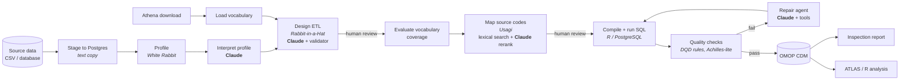

# Architecture

`omop-agent` automates the OHDSI ETL pipeline that data teams (for example at APHRC) run by
hand with White Rabbit, Rabbit-in-a-Hat, Athena, Usagi, SQL/R, Achilles and the Data Quality
Dashboard. The same stages remain, but each is either automated deterministically or drafted
by Claude and checked by code. A human can review and edit every hand-off between stages.

## Design principles

1. **Claude drafts, code verifies.** Every LLM output is a pydantic model validated on
   arrival. Concept ids are checked against the loaded vocabulary, since the model can only
   choose among candidates or ids that exist. Generated SQL is `EXPLAIN`ed before it runs.
   Data-quality results come from SQL, never from the model.
2. **Patient data never goes to the LLM.** Prompts contain aggregate metadata only: names,
   types, counts, ranges and frequent values. Values seen fewer than `min_cell_count` times,
   and every value of a detected direct identifier (names, phones, IDs, GPS), are withheld by
   construction (`omop_agent/privacy.py`). The repair agent can only run aggregate queries
   whose small groups are suppressed. Every prompt is stored verbatim in
   `work/llm_calls/` for audit.
3. **Human in the loop at the right places.** The ETL spec (`etl_spec.yaml`) and the
   vocabulary mappings (`mappings/*.csv`, Usagi-like columns) are plain files. `omop-agent
   run` stops after each one unless `--yes` is passed. Edits are picked up on the next step.
4. **Deterministic replays.** Every LLM call has a `(stage, key)` name. With
   `llm.record_dir` a live run is recorded; with `provider: replay` it runs offline. The demo
   and the test-suite use hand-written replays.
5. **Everything is audited.** `work/audit.jsonl` records stage transitions, LLM calls (with
   token usage), human approvals, SQL errors and each repair made to the spec.

## Stages and modules

| Stage | Module | Output |
|---|---|---|
| Stage source | `profiling/loader.py` | `src.*` text tables, `staging_manifest.json` |
| Profile | `profiling/profiler.py`, `profiling/render.py` | `profile.json`, `profile.md` |
| Interpret | `profiling/annotate.py` | `annotations.json` |
| Load vocabulary | `vocab/loader.py` | vocabulary tables |
| Design | `design/designer.py`, `design/validate.py`, `design/render.py` | `etl_spec.yaml`, `etl_spec.md` |
| Evaluate vocabulary | `vocab/evaluate.py` | `vocab_evaluation.json` |
| Map codes | `vocab/mapper.py`, `vocab/review.py` | `mappings/*.csv`, `etl.source_to_concept_map` |
| Build | `etl/compiler.py`, `etl/runner.py` | `sql/*.sql`, CDM tables, `etl_run.json` |
| Quality | `quality/checks.py`, `quality/dqd_r.py` | `dq_results.json` |
| Repair | `quality/repair.py` | updated `etl_spec.yaml`, `repairs.json` |
| Report | `report/inspection.py` | `report.md`, `report.html` |
| Orchestration | `pipeline.py`, `cli.py` | `state.json` |

## The ETL spec

`ETLSpec` (`omop_agent/models.py`) is the hand-off between design and build, in the role of
a Rabbit-in-a-Hat document, and it compiles directly to SQL. Each `TableMapping` becomes one
`INSERT INTO cdm.<table> SELECT ... FROM src.<table> <alias> [JOIN ...] [WHERE ...]`. Each
`FieldMapping.kind` compiles to:

| kind | SQL |
|---|---|
| `column`, `expression`, `constant` | the expression, cast to the CDM column type |
| `person_id` | `JOIN etl.person_map pm ON pm.source_value = (expr)::text`: unmatched rows are dropped (and counted) |
| `visit_id` | `LEFT JOIN etl.visit_map` (INNER when the field is required) |
| `auto_id` | `max(existing id) + ROW_NUMBER() OVER ()`, so several mappings can feed one table |
| `vocab_code` | `LEFT JOIN vocab.concept` on code+vocabulary, then `Maps to` for `concept_role: standard` |
| `concept_map` | `LEFT JOIN etl.source_to_concept_map` on code+`source_vocabulary_id` |
| `null` | `NULL` |

Concept lookups yield `0` when the source value exists but has no mapping. When the source
value is NULL they yield NULL, or 0 if the CDM field is required. `varchar(n)` targets are
truncated to `n` characters. The `cdm_source` row is generated from `cdm_source` in the config;
`cdm_version_concept_id` is looked up in the vocabulary (CDM vocabulary, code `CDM v5.4`), or
0 if that vocabulary isn't loaded. Placeholders `{cdm}`, `{vocab}`, `{src}`, `{etl}`, `{results}` in
expressions and custom SQL resolve to the configured schemas.

## Quality gate and repair loop

The built-in checks re-implement the Data Quality Dashboard field- and table-level checks in
PostgreSQL. Names, thresholds and severities are read from DQD's own v5.4 metadata (bundled in
`resources/ohdsi`), so results line up with DQD. An extra `etlRecordRetention` check compares
source rows with loaded rows for each table mapping. The run passes when no check with a
blocking severity (default `fatal`) fails and no ETL step errored. Otherwise the repair agent
gets the failures and a set of tools:

* `get_table_mapping`, `get_cdm_table`, `get_source_profile`: read context;
* `run_aggregate_query`: read-only SQL that must return a count column `n`; groups with
  `n < min_cell_count` are withheld and PII columns are refused;
* `update_field_mapping`, `replace_table_mapping`: change the spec. A change is applied only
  if the table still compiles and `EXPLAIN`s cleanly.

The ETL is rebuilt and re-checked, up to `quality.max_repair_iterations` times. Each change is
recorded in `repairs.json` and the audit log.

With `quality.use_r_dqd: true` and R available, the official Achilles and
DataQualityDashboard packages also run through a generated R script. Their JSON results feed
the same gate.
