# Architecture

`omop-agent` automates the OHDSI ETL pipeline that data teams (for example at APHRC) run by
hand with White Rabbit, Rabbit-in-a-Hat, Athena, Usagi, SQL/R, Achilles and the Data Quality
Dashboard. The same stages remain, but each is either automated deterministically or drafted
by Claude and checked by code. A human can review and edit every hand-off between stages.

```mermaid
flowchart LR
    SRC[(Source data<br/>CSV / database)] --> STAGE[Stage to Postgres<br/><i>text copy</i>]
    STAGE --> PROF[Profile<br/><i>White Rabbit</i>]
    PROF -->|privacy review| ANN[Interpret profile<br/><b>Claude</b>]
    ATH[Athena download] --> VLOAD[Load vocabulary]
    ANN --> DES[Design ETL<br/><i>Rabbit-in-a-Hat</i><br/><b>Claude</b> + validator]
    VLOAD --> DES
    DES -->|human review| VEVAL[Evaluate vocabulary<br/>coverage]
    VEVAL --> MAP[Map source codes<br/><i>Usagi</i><br/>lexical search + <b>Claude</b> rerank]
    MAP -->|human review| BUILD[Compile + run SQL<br/><i>R / PostgreSQL</i>]
    BUILD --> DQ[Quality checks<br/><i>DQD rules, Achilles-lite</i>]
    DQ -->|fail| REP[Repair agent<br/><b>Claude</b> + tools]
    REP --> BUILD
    DQ -->|after repairs| RDQD[Official DQD + Achilles<br/><i>R, optional</i>]
    RDQD -->|pass| CDM[(OMOP CDM)]
    CDM --> REPORT[Inspection report]
    CDM --> ATLAS[ATLAS / R analysis]
```

## Design principles

1. **Claude drafts, code verifies.** Every LLM output is a pydantic model validated on
   arrival. Concept ids are checked against the loaded vocabulary, since the model can only
   choose among candidates or ids that exist. Generated SQL is `EXPLAIN`ed before it runs.
   Data-quality results come from SQL, never from the model.
2. **Patient data never goes to the LLM.** Prompts contain aggregate metadata only: names,
   types, counts, coarsened ranges and frequent values. Values seen fewer than
   `min_cell_count` times, and every value of a detected direct identifier (names, phones,
   e-mail, ID numbers, addresses, GPS, free text), are withheld by construction
   (`omop_agent/privacy.py`). Detection uses column-name rules (including common local ones
   such as `nupi`, `ccc_no` and the WHO verbal-autopsy name fields) and value patterns; a
   column Claude labels as an identifier or free text is withheld from then on. Before the
   first call a reviewer approves the profile exactly as Claude will see it (the privacy
   review, `privacy_review.py`). The repair agent can
   only count records through a tool that builds the query itself, withholds small groups and
   refuses identifiers. Database errors are redacted before they reach the model. Every prompt
   and tool result is stored verbatim in `work/llm_calls/` for audit.
3. **Human in the loop at the right places.** What is sent to Claude, the ETL spec
   (`etl_spec.yaml`) and the vocabulary mappings (`mappings/*.csv`, Usagi-like columns) are
   each reviewed before the pipeline moves on, unless `--yes` is passed. Spec and mappings are
   plain files; edits are picked up on the next step.
4. **Deterministic replays.** Every LLM call has a `(stage, key)` name. With
   `llm.record_dir` a live run is recorded; with `provider: replay` it runs offline. The demo
   and the test-suite use hand-written replays.
5. **Everything is audited.** `work/audit.jsonl` records stage transitions, LLM calls (with
   token usage), each review gate and its outcome, SQL errors and each repair made to the
   spec.

## Stages and modules

| Stage | Module | Output |
|---|---|---|
| Stage source | `profiling/loader.py` | `src.*` text tables, `staging_manifest.json` |
| Profile | `profiling/profiler.py`, `profiling/render.py` | `profile.json`, `profile.md` |
| Privacy review | `privacy.py`, `privacy_review.py` | `privacy_review.json`, `privacy_review.md` |
| Interpret | `profiling/annotate.py` | `annotations.json` |
| Load vocabulary | `vocab/loader.py` | vocabulary tables |
| Design | `design/designer.py`, `design/validate.py`, `design/render.py` | `etl_spec.yaml`, `etl_spec.md` |
| Evaluate vocabulary | `vocab/evaluate.py` | `vocab_evaluation.json` |
| Map codes | `vocab/mapper.py`, `vocab/review.py` | `mappings/*.csv`, `etl.source_to_concept_map` |
| Build | `etl/compiler.py`, `etl/runner.py` | `sql/*.sql`, CDM tables, `etl_run.json` |
| Quality | `quality/checks.py`, `quality/dqd_r.py` | `dq_results.json` |
| Repair | `quality/repair.py` | updated `etl_spec.yaml`, `repairs.json` |
| Report | `report/inspection.py` | `report.md`, `report.html` |
| Orchestration | `pipeline.py`, `cli.py` | `state.json` |

## The ETL spec

`ETLSpec` (`omop_agent/models.py`) is the hand-off between design and build, in the role of
a Rabbit-in-a-Hat document, and it compiles directly to SQL. Each `TableMapping` becomes one
`INSERT INTO cdm.<table> SELECT ... FROM src.<table> <alias> [JOIN ...] [WHERE ...]`. Each
`FieldMapping.kind` compiles to:

| kind | SQL |
|---|---|
| `column`, `expression` | the expression, converted to the CDM column type tolerantly, with its own casts and `to_date` / `to_timestamp` calls (see "Tolerant conversion"); a NULL required value follows the CDM convention (see "How a mapping compiles") |
| `constant` | the literal, cast to the CDM column type (a bad constant fails `EXPLAIN`, so the validator reports it) |
| `person_id` | `JOIN etl.person_map pm ON pm.source_value = (expr)::text`: unmatched rows are dropped (and counted). Required for every `person_id` field, including `person.person_id` |
| `visit_id` | `LEFT JOIN etl.visit_map` (INNER when the field is required); in every table but `visit_occurrence` the visit must belong to the row's person |
| `auto_id` | `max(existing id) + ROW_NUMBER() OVER ()`, so several mappings can feed one table |
| `vocab_code` | `LEFT JOIN vocab.concept` on code+vocabulary, then `Maps to` for `concept_role: standard` |
| `concept_map` | `LEFT JOIN etl.source_to_concept_map` on code+`source_vocabulary_id` |
| `null` | `NULL` |

The id maps are kept across re-runs, so a person keeps the same `person_id`, and no id is
given to another key. After `person` and `visit_occurrence` load, map entries for people or
visits that did not become a row (filtered out by the mappings, or a failed load) are retired
to `etl.person_map_retired` / `etl.visit_map_retired`, so events can't point at them; a retired
key that returns gets its old id back, and new keys are numbered after the largest id in the
map or retired. (Versions before the retired tables deleted such keys, so the first build after
an upgrade can give a deleted key's id to a new key once.) The visit pruning step also records
the person each loaded visit belongs to (`visit_map.person_source_value`; for a visit key loaded
for two people, the smaller person key, so the choice is the same on every run). The build
re-validates the spec first, because it may have been edited by hand. Retention is measured
before vocabulary fan-out (`TableLoadResult.retained_rows`), so one-to-many mappings can't hide
dropped records.

**Several key sources.** Besides `person_key` / `visit_key`, every `person` and
`visit_occurrence` mapping whose key is not the key expression over the key table
(`compiler.key_sources`) adds the keys of its rows (its `FROM`, joins and `WHERE`) to the id map
in its own step (`person_map_2`, `visit_map_2`, ...), restored and numbered like the others, so
one failing source loses only its own keys. A key found in two sources is one person (visit):
the validator warns about keys from another table without a prefix, about a mapping on the key
table that writes the key in another form, and about a record's visit key whose shape matches
no visit source.

**Visit links.** A record's `visit_occurrence_id` joins the visit map on the key *and* on the
row's person (`visit_map.person_source_value = person_map.source_value`), so a record never
points at another person's visit. The retained-row count of each such mapping classifies its
rows in the same pass (`stats["visit_links"]`): with a key, linked, naming another person's
visit, or filtered: no loaded visit, but a key of a visit mapping's source rows (read before
its filter, so a filtered-out or dropped visit counts here, while a `visit_key` that no visit
mapping writes and keys of an older spec do not). The rest name a key that no visit mapping
reads.

**Observation periods.** With `observation_period: table_mapping` the mappings (or custom
SQL) load one row per source episode (residency, enrolment, follow-up), with a NULL end for an
episode that is still open; with `from_events` the build derives one period per person from
their first to their last record. After the last writer of `observation_period`, and so after
`death`, the `observation_period_merge` step replaces those rows by each person's periods, in
one statement that returns its statistics (`TableLoadResult.stats`):

* an episode is open when its end is NULL (loaded as `9999-12-31`) or a placeholder on or after
  2099-01-01. It ends at the source release date, or at the person's death when that comes
  first; an open episode that starts after the release date, or after the person's death, keeps
  one day. Real exits are never clipped. Periods derived from the records (`from_events`) are
  never open: the merge only renumbers them and derives the release date;
* the release date is `cdm_source.source_release_date` when configured. Otherwise it is derived
  from the data, without the build date: the k-th latest exit of the valid closed episodes,
  k = max(5, n / 10,000), so a few mistyped future exits do not move it (with too few closed
  episodes, the k-th latest start, then the earliest start). It is stored in
  `etl.build_facts` (emptied at the start of every build) and written to
  `cdm_source.source_release_date`;
* episodes that end before they start are dropped and counted; the others merge where they
  overlap or are back to back (DQD `measureObservationPeriodOverlap`: an end + 1 day = the next
  start), keeping the type of the first episode. Periods are numbered from 1.

The statistics are `episodes`, `inserted` (periods), `dropped_inverted`, `open_episodes`,
`open_closed_at_death`, `open_starting_after_death`, `open_starting_after_release`,
`exits_after_release`, `ending_from_release` (periods that end on the release date or later),
`persons_overlapping` (true overlaps, not adjacency), `persons_stale_open` (an open episode
followed by a later one), `persons`, `persons_without_period` (persons whose episodes were all
dropped), `release_date`, `configured` and `closed_episodes`; the report's ETL table shows the
episodes, periods, dropped and open episodes and the persons with overlapping or stale open
episodes. With `table_mapping` the `observation_period_fill` step then
gives every person without a period one from their first to their last record (not clipped), so
clinic-only persons and persons with only invalid episodes are observed; it returns `inserted`
and the `persons_without_period` before it. `etlObservationPeriodMerge` reports the episodes
whose dates the merge could not use as written: those dropped, and those loaded as open because
the mapping could not read their exit date (convention, 5%; a fatal `etlRecordLoss` copy when
more than 100 - `min_record_retention_pct` percent are dropped), with the other statistics.
`etlSourceReleaseDate` (convention, threshold 0, not repairable) fails while open episodes end on
a derived date (set `cdm_source.source_release_date` to the extract date), or when episodes start
(open) or end after a configured date (stale); it is fatal when the derived date is after the day
of the build (placeholder or mistyped exit dates). When the build derived periods (the fill, or
`from_events`), `measurePersonCompleteness.observation_period` counts persons without a valid
episode and without a record: it still blocks, but is not sent to the repair agent. The repair
agent may not change which episodes are open: an edit of the end date that opens episodes with
real exit dates, or gives open ones their start date, is refused (the dry run, and the
validator's end-date rules), and the build history counts the valid episodes the merge took (not
the merged periods, which a fix of an episode's dates can join).
`withinObservationPeriod` (characterization, 5%) counts the records of each event and era table
whose start date lies in no period of their person.

**Routing by domain.** The CDM puts a record in the table of its standard concept's domain, but a
spec maps each source table to one table (an ICD-10 diagnosis list also holds observations such
as Z34.9 and procedures). With `route_by_domain: true` (the default) the build moves the
records after every writer of the event tables, in a block of generated steps after `specimen`
and before `payer_plan_period`, `cost`, the observation periods and the eras, which read or refer
to the records where they end up (`etl/routing.py`):

* `route_prepare` stores the largest id of each of the six event tables in `etl.id_high_water`;
  then one `route_<table>` step per table the spec loads among `condition_occurrence`,
  `procedure_occurrence`, `drug_exposure`, `device_exposure` and `measurement` deletes the
  records whose standard concept (`*_concept_id`, not 0) belongs to another of the event domains
  Condition, Procedure, Drug, Device, Measurement and Observation, and inserts them into that
  domain's table, in one statement. `observation` is a destination only (DQD has no `fkDomain`
  on `observation_concept_id`). A concept of any other domain (Meas Value, Unit, Type Concept,
  ...) is never moved, so `fkDomain` keeps reporting it, and neither is a record with concept 0;
* fields are carried by role (`cdm.spec.EVENT_FIELD_ROLES`: start date, type, source value,
  visit, ...). `drug_exposure_end_date` takes the start date when the record has no end; a
  quantity becomes an integer only when it is one (`CASE WHEN q = trunc(q) AND q BETWEEN ...`,
  so a fraction, NaN or overflow gives NULL instead of failing the step). A value the
  destination has no place for (a measurement's range or operator, a drug's days_supply) is
  dropped and the moved rows that had one are counted. A measurement with a result
  (`value_as_number`, `value_as_concept_id` or `value_source_value`) whose concept is a
  condition, procedure, drug or device goes to `observation`, which keeps the result;
* a moved record gets an id after the larger of its destination's largest id and the one stored
  before routing, so an id that a move freed is never given to another record;
* the misplaced concepts are found from the distinct concepts of the table: by an indexed lookup
  when `vocab.concept` has an index on `concept_id` (the runner probes it; `load_vocabulary`
  creates the vocabulary indexes also when the vocabulary was loaded by someone else), else by a
  hash join of the concept table.

Each route step returns one row per destination and domain (`TableLoadResult.moved`); the report
lists them ("Records moved to the table of their concept's domain"), and `etlDomainRouting`
(characterization, never failed) reports them per step. Route steps are not blocking: when one
fails, the records stay where they were loaded and the error is reported (`etlStepError`,
convention, not sent to the repair agent), and the table's `fkDomain` failure is not sent to the
repair agent either. A mapping that routes by hand (a WHERE or inner join testing
`{vocab}.concept` `domain_id` against an event domain, or the same codes of the same rows as
another mapping of its source table into another event table) loads records twice: the
validator warns, the repair agent may not add one, and each build reports it as a failed
`etlHandRouting` (convention, not repairable). Every table the route steps can write is emptied
before each build, and a destination counts as populated for the checks only when records were
moved there. Concept lookups for the main concept field of a routed table accept the other
domains of the table (`cdm.spec.ACCEPTED_DOMAINS`: a condition code may map to an Observation,
Procedure or Measurement concept, a procedure code to an Observation or Measurement concept, a
measurement to an Observation concept, a drug and a device to each other's domain): the mapper
finds the target domain's candidates as before and shows the best three of each other accepted
domain on top of them (one trigram retrieval per term serves all its domains), its exact and
lexical shortcuts pick only concepts of the target domain, and a model's choice of another domain
is never approved automatically. Fields that share a source vocabulary share one set (the union
over routed fields, the intersection over the others); the validator warns when a field can get
a concept of a domain it does not accept, and when the fields of one vocabulary expect different
target domains (then no concept of it is approved without a reviewer), when a mapping routes by
hand (a WHERE or inner join testing the domain of `vocab.concept` against an event domain), and
when two mappings of one source table read the same codes from the same rows into two event
tables, and the repair agent may not add either. Not
routed (by design): records out of `observation`, concept-0 records by their source concept,
and the value of a 'Maps to value' relationship.

Concept lookups yield `0` when the source value exists but has no mapping. When the source
value is NULL they yield NULL, or 0 if the CDM field is required. `varchar(n)` targets are
truncated to `n` characters. The `cdm_source` row is generated from `cdm_source` in the config;
`cdm_version_concept_id` is looked up in the vocabulary (CDM vocabulary, code `CDM v5.4`), or
0 if that vocabulary isn't loaded. Placeholders `{cdm}`, `{vocab}`, `{src}`, `{etl}`, `{results}` in
expressions and custom SQL resolve to the configured schemas.

### How a mapping compiles

The `SELECT` of a mapping's `INSERT` has layers. Each one is fenced with `OFFSET 0`, so
PostgreSQL neither merges them nor evaluates a value twice:

1. **Source rows.** The mapping's `FROM`, joins and `WHERE`, the id-map joins, every
   `column` / `expression` / `constant` / id value, and the code of every lookup (`_k1`, ...).
   Each value is computed once per source row, and the tolerant conversions count, per field,
   the values they could not read.
2. **Required values.** A required field that comes out NULL follows the CDM convention
   (`etl/policies.py`, derived from the CDM v5.4 field list) instead of failing the whole table
   on its NOT NULL constraint:

   | Required field | NULL becomes | Counted as |
   |---|---|---|
   | a concept (`*_concept_id`) | 0 | `defaulted` |
   | `visit_end_date`, `visit_detail_end_date`, `drug_exposure_end_date` | the start date | `defaulted` |
   | `observation_period_end_date` | `9999-12-31`: the episode is still open (the merge ends it) | - (the merge counts open episodes) |
   | any other: start and event dates, `year_of_birth`, `death_date`, `note_text`, ... | the row is dropped | `required_null` per field, `row.dropped` |

   This layer is left out when no required field is computed from the source.
3. **Lookups.** The vocabulary and `source_to_concept_map` joins on the layer-1 codes,
   `auto_id` and `null` fields. A code with several targets inserts several rows, but the counts
   above are per source row.
4. **One row per key** (`person`, `death`: one per person; `visit_occurrence`: one per visit and
   person). The layer-3 rows become the candidates of one statement (`WITH cand AS MATERIALIZED
   ... picked ... ins AS (INSERT ...) SELECT <statistics>`). Among the rows of a key the
   mapping's `dedup_order` wins (an `ORDER BY` list over the aliases, ranked in layer 1 and read
   tolerantly; `NULLS LAST` is added to every item that does not say where NULLs go, so a missing
   or unreadable value never wins), then the table's default (for death a date known to the day
   before one completed from a year or month, then the latest date), then the most complete
   row (a concept 0 counts as missing, so an unknown sex never wins over a known one), then the
   source row's text (compared byte-wise, `COLLATE "C"`): the choice is deterministic and
   prefers no value. A visit takes the earliest start and the latest end of its rows (window
   `MIN` / `MAX`), where the patient came from as in its first row and where they went as in
   its last (`FIRST_VALUE`). Rows with a NULL
   drop-policy field are gone in layer 2, so they never win. A key an earlier mapping loaded is
   skipped (an anti-join outside `DISTINCT ON`); a visit key shared by two people gives two rows,
   so `isPrimaryKey` still fails. The statement returns `inserted`, `source_rows_kept`, `keys`,
   `duplicate_rows`, `already_loaded_keys`, `conflict_keys` (rows that disagree on sex or birth
   year, the date of death, or a visit's person, among themselves or with the row an earlier
   mapping loaded), `undecided_keys` (person and death: keys whose best-ranked rows still
   disagree), `fan_out_keys` (a code with several concepts) and, for visits, `gap_keys` (visits
   whose rows are separate stays) into `TableLoadResult.stats`. A NULL (`null`) field is a typed
   NULL, so it passes through the candidates.

The counters are transaction-local settings (`omop_agent.<category>__<field>`) that the
helper functions in the ETL schema (`etl/functions.sql`: `omop_count`, `omop_drop`,
`omop_default_int`, `omop_derived_date`, `omop_derived_ts`) increase, only for the rows they count.
The runner reads them at the end of the step into `TableLoadResult.value_counts`, and
`retained_rows` is the rows that survived the id-map joins (`id_retained_rows`) minus the
dropped rows. So `etlRecordRetention` and the fatal `etlRecordLoss` see the drops.
`create_etl_tables` installs the functions with a version stamp: a version change must be
installed once by their owner, and a build role needs EXECUTE on them (PUBLIC by default). Spec
SQL may not call them (`sqlguard.py`).

### Tolerant conversion

Source columns are text, so field expressions convert them, and in PostgreSQL one value that
does not convert fails the whole statement. The compiler (`etl/tolerant.py`) rewrites every
`::date`, `::timestamp`, `::timestamptz`, `::integer` / `::bigint`, `::numeric` (and `CAST`),
`to_date(x, 'T')`, `to_timestamp(x, 'T')` and `{etl}.try_*(x, ...)` in `column` and `expression`
fields and in the mapping's `WHERE` into the counted helper functions
`omop_as_<kind>_at(field, policy, x[, 'T'])`, and then converts the field's value to its CDM type
the same way. A value they cannot read becomes NULL and is counted (`invalid`). Dates are read
strictly (31/02/2019 is invalid); a template separator matches any one separator (as in
`to_date`), a date-only template also takes a trailing time, ISO dates are read in any template,
and under ISO the year-first (`YYYYMMDD`, `YYYY/MM/DD`) and month-name (`5 Mar 2019`) forms are
read too. Words such as `today` are invalid. Floating-point casts are read as `numeric` (a later
integer conversion rounds halves away from zero, where `float8` rounds them to even).

A date with an unknown day or month (`00`, `97`-`99`, no day in the value such as `06/1975`
for `DD/MM/YYYY`, or a template without DD or MM) is completed by the field's rule
(`etl/policies.py`, `partial_policy`) and counted as `imputed`, or left NULL and counted as
`partial_null`: the start of a DQD start/end pair takes the first day, its end the last day,
other dates the 15th (`etl.partial_dates: reject` makes them NULL); birth and death dates follow
THEMIS (year and month of birth are kept, a missing birth day is the 1st and a year alone gives no
`birth_datetime`; a death date takes the last day). An imputed date is not later than the
configured `cdm_source.source_release_date` (else the build date). An offset (`Z`, `+03:00`)
converts the value to `etl.timezone` when it is set (`offset_converted`); unset, the wall clock is
kept as written (`offset_ignored`). Only offsets that are not the zone's own (unset: the
session's) are counted, since the zone's own changes nothing. A `::timestamptz` cast, and
`to_timestamp` with a `TZH` / `OF` template, keep the instant the offset gives; `to_timestamp`
with another template reads the wall clock as a timestamp does.

Constants keep their cast. Join conditions, keys and the `person_id`, `visit_id`, `vocab_code`
and `concept_map` expressions are evaluated as written (they are join keys); spec SQL may use the
uncounted `{etl}.try_date(x, 'T')`, `try_timestamp`, `try_timestamptz`, `try_integer`,
`try_bigint` and `try_number` there. The build's count queries use them for the `WHERE`, so they
stay parallel. No helper raises for any input value. Measured on 1M values (one core, as an
INSERT runs):

| values | time |
|---|---|
| ISO dates, or a numeric or month-name template with one-character separators (`DD/MM/YYYY`, `DD/MM/YYYY HH24:MI`, `DD-Mon-YYYY`): SQL fast paths | 1.2-2.7 s |
| ISO with fractional seconds or an offset (ODK `submitted_at`): SQL, PostgreSQL's own input functions after a strict check | about 6 s |
| any other template (`DD/MM/YY`, `DDMonYYYY`, `HH12 AM`, `TZH`), and invalid values: the PL/pgSQL parser `omop_walk` | about 13 s |
| the plain cast it replaces | 0.2-0.5 s |

The fast paths are SQL that PostgreSQL inlines into the statement, which it does only when the
value converted is cheap and not volatile (a column). For any other operand (one with a
conversion in it, say) the compiler writes the `*_once` form of the date functions
(`omop_as_date_once_at`), which reads the value in PL/pgSQL: about 2 s per 1M ISO values, about 13
s for another template.

The checks `etlInvalidValue` (per field and `where`; convention at 5% for date and required
fields; characterization for other fields, unless more than half of a field's values are
unreadable, then convention) and `etlPartialDate` (characterization, never failed) report the
counts. A row the `WHERE` could not decide because a value in it is unreadable is left out, and
counted as a dropped record by `etlRecordRetention` and the fatal `etlRecordLoss`. The validator
warns about a conversion the build has to leave as written, and about casts in joins and keys; an
ISO cast (or `try_date` without a template) of a column profiled with a day-first or month-first
format, in a field, join, key or custom SQL, and a strftime template such as `'%d/%m/%Y'`, are
errors.

## Quality gate and repair loop

The built-in checks re-implement the Data Quality Dashboard field- and table-level checks in
PostgreSQL. Names, thresholds and severities are read from DQD's own v5.4 metadata (bundled in
`resources/ohdsi`), so results line up with DQD. An extra `etlRecordRetention` check compares
source rows with rows kept after the person/visit joins and the required-field policies for
each table mapping. `etlRequiredFieldNull` reports, per field, rows dropped for a NULL required
value (convention; threshold 0 for `person`, because a dropped person takes their records along,
5% elsewhere), and `etlDefaultedValue` the NULL required values the build completed (convention,
5%), so the repair agent can write a better fallback where the source has one. For the tables
that keep one row per key, `etlDuplicateRecords` reports the rows that lost to another row of
their key (convention at 5% for `person`, where many mean a source of another grain; not
repairable; characterization otherwise), `etlKeyConflict` the keys whose rows disagree
(convention at 0 for the person keys whose best-ranked rows still disagree: all rows without a
`dedup_order`; characterization otherwise), `etlKeyFanOut` the keys with a code of several
concepts (convention, not repairable) and `etlVisitGrain` the visits rolled up from rows that are
separate stays, a visit key coarser than one visit (fatal above 5%, not repairable).
`etlVisitLinkage` reports records whose visit key gives no visit of their own person
(convention, 5%; rows whose key is one of a visit mapping's source rows that the mapping left
out are not counted: the retained count reads the visit mappings' keys before their filters),
and `etlVisitLinkLoss` fails fatally when more than 100 - `min_record_retention_pct` percent
name a key that no visit mapping reads. Two checks re-verify
after the load what custom SQL could break (fatal, threshold 0, not repairable):
`measureDuplicateDeaths` (one death per person) and `fkVisitPerson` (a record's visit belongs to
its person). `etlDomainRouting` (characterization) reports the records each route step moved to
the table of their concept's domain, and those that lost a value on the way. A route destination
that no mapping loads (its records were all moved there) usually fails
`measurePersonCompleteness`; that result is not sent to the repair agent, and a repair after which
such a table receives no records is not treated as data loss. DQD checks the
built-in engine doesn't implement are listed as not applicable, and so is each empty table, as a
single summary row. The run passes when no check with a
blocking severity (default `fatal`) fails, no check listed in `quality.blocking_checks` fails
(by default `measurePersonCompleteness` on `observation_period`, because analyses in ATLAS
need every person to have one) and no ETL step errored. A table mapping that keeps fewer than
`quality.min_record_retention_pct` (default 50%) of its source rows fails the fatal
`etlRecordLoss` check, so a build that silently drops most records cannot pass. Otherwise the
repair agent gets the failures and a set of tools:

* `get_table_mapping`, `get_cdm_table`, `get_source_profile`: read context;
* `count_records`: counts only. The tool builds `SELECT g…, COUNT(*) AS n FROM <table>
  WHERE <typed filters> GROUP BY g HAVING COUNT(*) >= min_cell_count` itself, with bound
  parameters. Identifiers, patient keys and record ids can't be grouped or filtered.
  Vocabulary tables are reference data and are not suppressed;
* `update_field_mapping`, `replace_table_mapping`: change the spec. A change is applied only
  if it passes the SQL guard (`sqlguard.py`) and the PII and person-link rules, and the table
  still compiles and `EXPLAIN`s cleanly. An edit identical to the current mapping is a no-op.
  The repair agent may not make a check pass by removing data: adding or changing a `WHERE`
  filter, adding an inner join, changing the source table, blanking a field or removing a
  field mapping is rejected, and the agent is told to leave such failures to a person. So are
  edits that change who exists in the CDM or whose records are whose: a changed person_id
  expression (in any table, unless the mapping cannot run at all, e.g. a misspelled key column),
  a changed key of `person` or `visit_occurrence`, a new mapping into `person`,
  `visit_occurrence` or `death`, or a removed or changed filter of those tables. An edit that
  makes a record's visit key NULL where it was not (a blank or NA-marker key aside) is refused
  too: it would hide records that lost their visit from `etlVisitLinkage`.

Errors of steps the build generates (id-map pruning, routing, ...) and errors a spec change cannot
fix (a missing privilege of the ETL role: the error names the GRANT to run) are never sent to the
repair agent. Neither is an edit that routes records by hand while the build routes them (a filter
or join on the domain of `vocab.concept`, or a second mapping of the same codes into another
event table): it is refused, because it would load those records twice.

The ETL is rebuilt and re-checked, up to `quality.max_repair_iterations` times. Each build is
scored: losing data (a CDM table keeping under 95% of the rows an earlier build loaded, or of
its records with a visit key or linked to their visit, or checks that applied before becoming
not applicable) ranks below any number of failing checks,
then ETL errors, then blocking and repairable failures. An iteration that makes the score worse
is rolled back to the best spec, rebuilt, and its repairs are marked `reverted` in
`repairs.json`. `etl_spec.before_repair.yaml` keeps the spec as it was before automatic
repairs, and every change is recorded in `repairs.json` and the audit log.

With `quality.use_r_dqd: true` and R available (the `Dockerfile.r` image, or
`deploy/r/install_r_dqd.sh`), the official Achilles and DataQualityDashboard packages run once,
on the CDM the repair loop settled on, through a generated R script
(`quality/r/run_achilles_dqd.R`). Their results replace the built-in ones for the checks DQD
ran and feed the same gate; the report's engine reads `builtin+dqd`. If R is missing or fails,
the run says so and falls back to the built-in checks, unless `quality.require_r_dqd` is set,
in which case the run fails. Vocabulary coverage is measured again on the final build.

## Review gates, the web app and deployment

The pipeline stops three times for people:

* **privacy**: before the first call to Claude (only when `llm.provider` is `anthropic`). The
  reviewer sees the withheld columns and the profile text exactly as it will be sent. The
  digest covers that text and the privacy and LLM settings, so a new source extract or a
  changed setting needs a new approval;
* **design**: after the ETL design;
* **vocab_map**: after code mapping.

How a gate decides depends on how the pipeline is run:

* `omop-agent run` asks at the terminal; `--yes` skips all gates (for demos and CI), and the
  report then says the run was not fully reviewed.
* `omop-agent run --recorded-approvals`, and every run started from the web app, continue only
  when a reviewer approved what the gate shows *as it is now*. `approvals.py` stores each
  approval in `work/approvals.json` with a sha256 digest. For the design, the digest covers the
  validated spec, so formatting and comments don't count. For the mappings, it covers each
  term's target concept and status. A hand edit, a redraft, a repair, a changed mapping or a
  new source code changes the digest, and the run stops with status `waiting_review`. A copy of
  what was approved is kept under `work/approvals/`, so the web app can show what changed.

A stopped run is continued by a plain run. What the stopped run was asked to redo (start over,
redraft the design, map again) is kept in `work/pending_run.json` until that step has run, so
stopping at the privacy review, which comes before that work, doesn't lose the request.

Every gate writes a `review_gate` audit event (approved, skipped, stopped or not checked). The
report's Reviews table is built from those events and the approvals, and a PASSED verdict
carries a "Not fully reviewed" caveat when a gate was skipped, the repair agent changed the
design after it was approved, or mappings nobody reviewed (`UNCHECKED`) were loaded.

The web app (`omop_agent/web/`, FastAPI with server-rendered Jinja pages) is an interface to
the same files the command line uses, not a separate system:

* Mapping edits change cells of `mappings/<vocabulary>.csv` (`vocab/review.py:update_review_row`,
  under a file lock), exactly as a spreadsheet edit would. `import_review` applies them on the
  next run. Each edit records `reviewed_by`, `reviewed_at` and `review_note`, which are carried
  into `decisions.json`.
* Runs are separate processes (`web/worker.py`) that hold `work/jobs/run.lock`, one per
  project. Their records and logs are in `work/jobs/`. Mapping edits are refused while a run is
  in progress, and forms carry the state the reviewer saw (expected concept and status, gate
  digest), so nobody approves or overwrites a change they did not see.
* Accounts (`web/users.py`) are local, have three roles (viewer, reviewer, operator) and are
  managed with `omop-agent users` on the server. Sessions are signed cookies (strict SameSite,
  `Secure` behind HTTPS) that end when the account changes. Every form has a CSRF token. Pages
  load no external assets and no inline scripts, under a strict Content-Security-Policy.

`deploy/` packages it for one server: an image with the CLI and the app (non-root), and
PostgreSQL 16 with `pg_trgm` and an application role that owns its database but is not a
superuser. The database is not published outside the compose network. See `docs/deploy.md`.
